# Changan Qiyuan - русский перевод для LSPosed

Неофициальный LSPosed-модуль, переводящий интерфейс Android-приложения
Changan Qiyuan на русский язык без изменения и переподписи оригинального APK.

Целевой пакет:

```text
com.changan.oushangCos1
```

## Возможности

- перевод китайского текста в обычных элементах Android-интерфейса;
- проверенный словарь для коротких подписей, где машинный перевод неточен или
  не помещается на экране;
- динамический перевод текстовых узлов WebView через Google Translate;
- сохранение полученных переводов между запусками приложения;
- перевод текста, который нестандартные компоненты рисуют на Canvas;
- английский логотип на экране входа и английский бейдж отметки в профиле;
- исходный APK Changan Qiyuan остаётся неизменным.

Текст, встроенный непосредственно в фотографии и рекламные баннеры,
автоматически не переводится.

## Скриншоты

Нажмите на миниатюру, чтобы открыть изображение в полном размере.

<table>
  <tr>
    <td align="center"><a href="docs/screenshots/overview.png">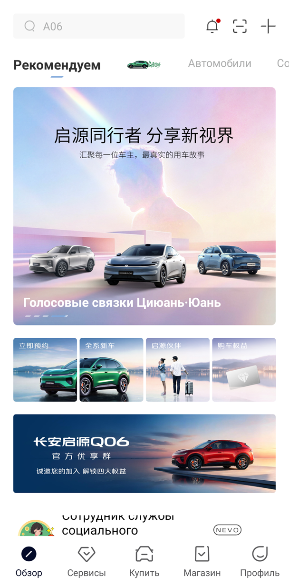</a><br><sub>Главная страница</sub></td>
    <td align="center"><a href="docs/screenshots/services.png">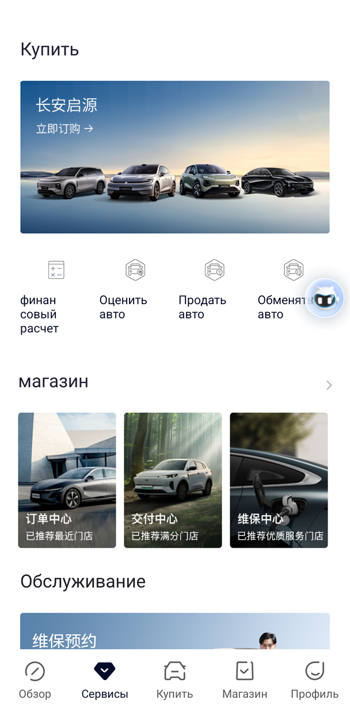</a><br><sub>Сервисы</sub></td>
    <td align="center"><a href="docs/screenshots/vehicles.png">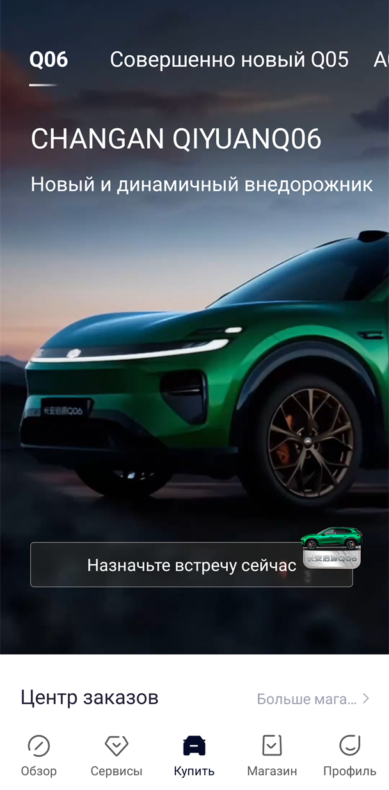</a><br><sub>Выбор автомобиля</sub></td>
  </tr>
  <tr>
    <td align="center"><a href="docs/screenshots/store.png">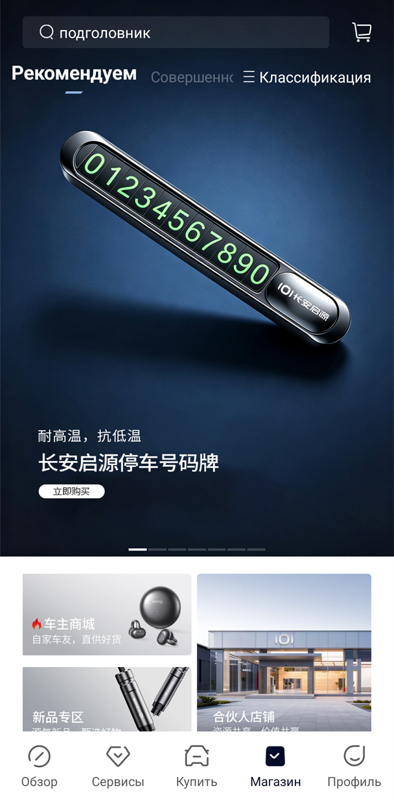</a><br><sub>Магазин</sub></td>
    <td align="center"><a href="docs/screenshots/profile.png">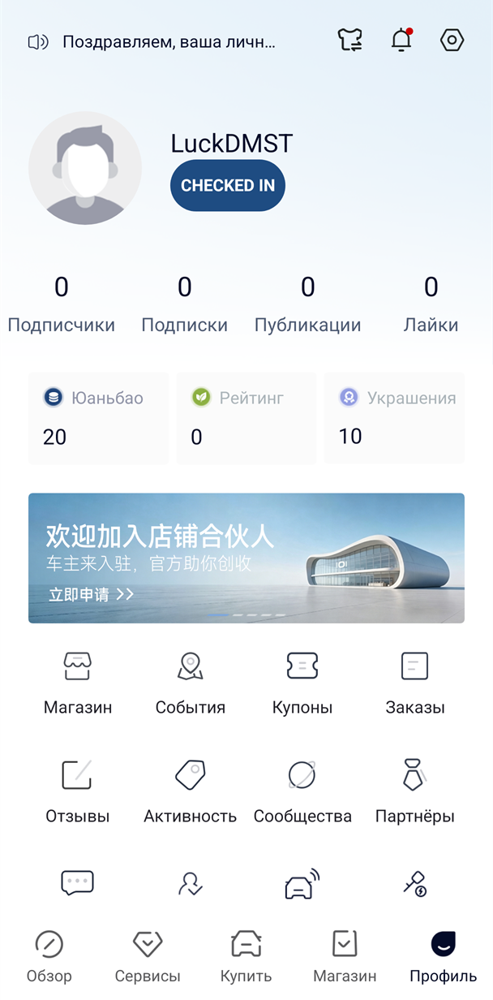</a><br><sub>Профиль</sub></td>
    <td align="center"><a href="docs/screenshots/profile-features.png">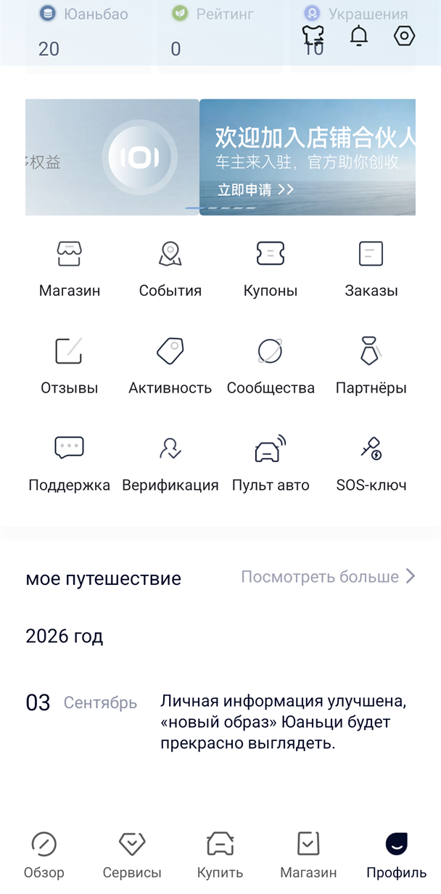</a><br><sub>Разделы профиля</sub></td>
  </tr>
  <tr>
    <td align="center"><a href="docs/screenshots/settings.png">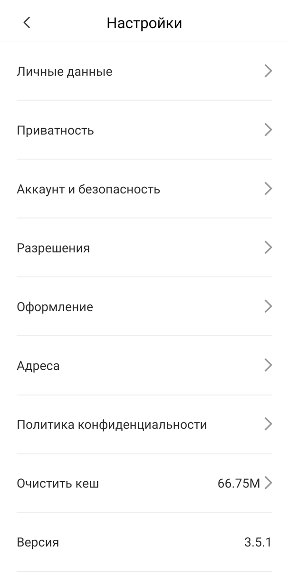</a><br><sub>Настройки</sub></td>
    <td align="center"><a href="docs/screenshots/permissions.png">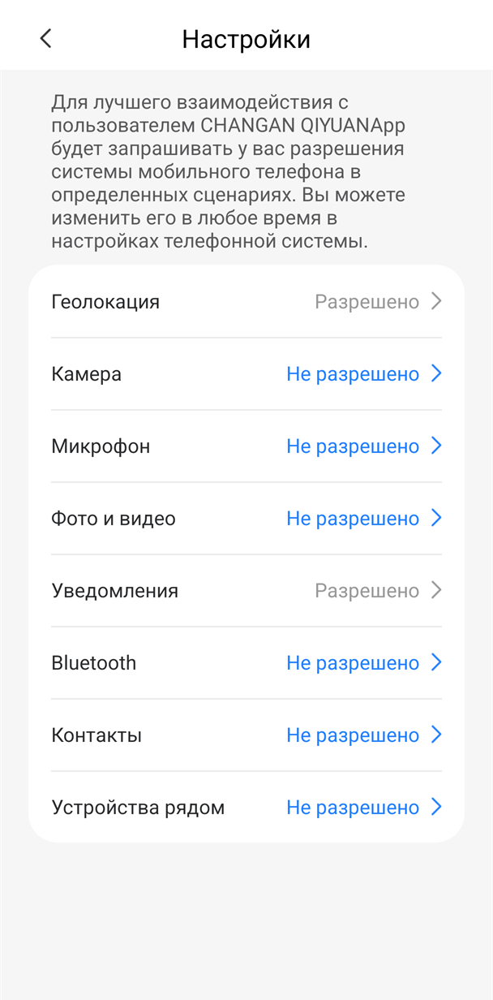</a><br><sub>Разрешения приложения</sub></td>
    <td align="center"><a href="docs/screenshots/privacy.png">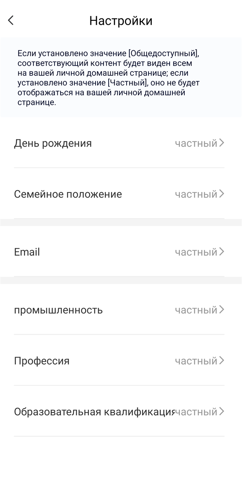</a><br><sub>Настройки приватности</sub></td>
  </tr>
  <tr>
    <td align="center"><a href="docs/screenshots/personal-data.png">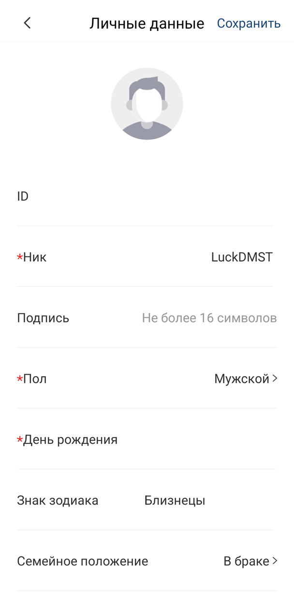</a><br><sub>Личные данные</sub></td>
    <td align="center"><a href="docs/screenshots/gender-picker.png">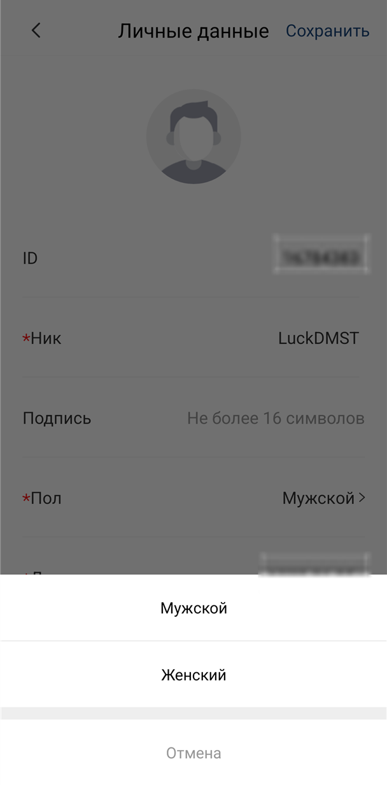</a><br><sub>Выбор пола</sub></td>
    <td align="center"><a href="docs/screenshots/relationship-picker.png">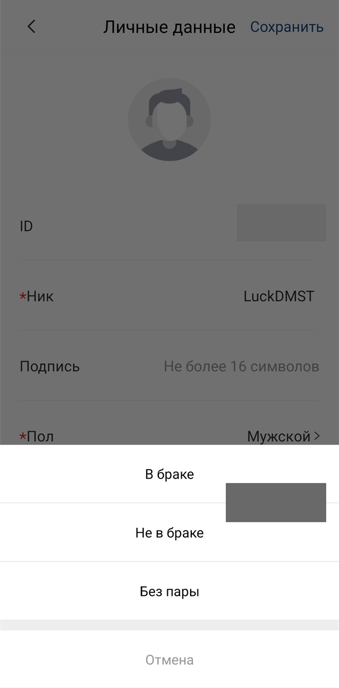</a><br><sub>Семейное положение</sub></td>
  </tr>
  <tr>
    <td align="center"><a href="docs/screenshots/address-picker.png">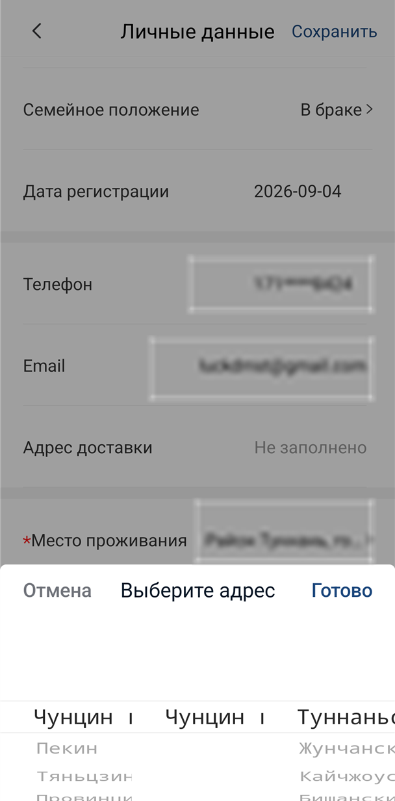</a><br><sub>Выбор адреса</sub></td>
    <td align="center"><a href="docs/screenshots/translated-webview.png">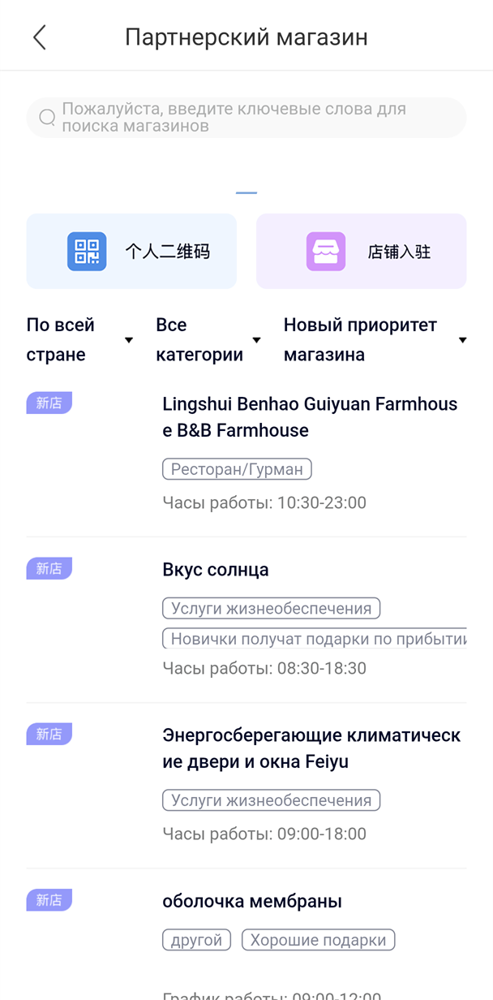</a><br><sub>Перевод WebView</sub></td>
    <td align="center"><a href="docs/screenshots/translated-toast.png">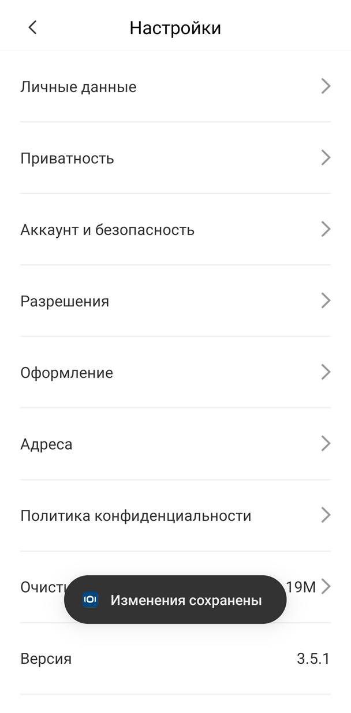</a><br><sub>Всплывающее сообщение</sub></td>
  </tr>
</table>

## Что потребуется

### Для работы модуля

- Android-устройство с root-доступом через Magisk;
- включённый Zygisk;
- установленный и работающий LSPosed;
- Android 8.0 или новее, так как минимальная версия модуля указана как API 26;
- оригинальное приложение Changan Qiyuan с пакетом
  `com.changan.oushangCos1`;
- APK этого модуля из раздела [Releases](https://github.com/LuckDMST/Changan-Qiyuan-Russian-LSPosed/releases);
- доступ в интернет по HTTPS к `translate.googleapis.com` для новых строк.

Приложение Google Переводчик отдельно устанавливать не требуется. Модуль
сам отправляет видимые китайские строки в Google Translate и получает перевод.

### Для сборки из исходников

- JDK 17;
- Android SDK Platform 35;
- Android SDK Build Tools 35;
- Gradle 8.7, который указан в Gradle Wrapper;
- Android Gradle Plugin 8.5.2;
- Xposed API 82, загружаемый из репозитория `api.xposed.info`;
- доступ в интернет при первой сборке для загрузки Gradle-плагина и Xposed API.

Android Studio для сборки не требуется.

Получение root-доступа зависит от устройства и может привести к потере данных.
Используйте [официальную инструкцию Magisk](https://github.com/topjohnwu/Magisk/blob/master/docs/install.md).

Официальный репозиторий [LSPosed](https://github.com/LSPosed/LSPosed)
заархивирован владельцами. Перед установкой проверьте совместимость выбранной
сборки LSPosed с вашей версией Android и Magisk и загружайте её только из
источника, которому доверяете.

## Установка модуля

1. Убедитесь, что оригинальное приложение Changan Qiyuan уже установлено.
2. Скачайте `ChanganQiyuan-LSPosed-debug.apk` со страницы [Releases](https://github.com/LuckDMST/Changan-Qiyuan-Russian-LSPosed/releases).
3. Установите APK как обычное Android-приложение.
4. Откройте LSPosed Manager и перейдите в раздел **Модули**.
5. Включите **Changan Qiyuan - Русский**.
6. В области действия модуля отметьте только `com.changan.oushangCos1`.
7. Полностью остановите Changan Qiyuan и запустите его снова.

При обновлении этого модуля обычно достаточно перезапустить целевое приложение.
Перезагрузка телефона требуется после установки или обновления самого Magisk,
Zygisk либо LSPosed, если этого требует их установщик.

## Обновление модуля

Новые версии публикуются на странице [Releases](https://github.com/LuckDMST/Changan-Qiyuan-Russian-LSPosed/releases).
APK можно установить поверх предыдущей версии, после чего достаточно полностью
остановить и снова запустить Changan Qiyuan.

Для появления обновлений во встроенном каталоге LSPosed модуль подаётся в
[Xposed Modules Repository](https://modules.lsposed.org/submission/). До принятия
заявки используйте страницу Releases.

## Root-обнаружение и DenyList

Этот проект переводит интерфейс и сам по себе не скрывает root-доступ.
Не отключайте Magisk DenyList глобально ради одного приложения: это может открыть
root другим приложениям из списка. Сокрытие root зависит от версий Magisk,
LSPosed и прошивки и настраивается отдельно.

## Конфиденциальность и сеть

Для динамического перевода модуль отправляет видимые китайские текстовые строки
на endpoint Google Translate `translate.googleapis.com`. Изображения, команды
управления автомобилем и бинарные данные модуль туда не отправляет.

Если Google Translate недоступен в вашей сети, новые строки останутся на
китайском. Может потребоваться VPN, настроенный самим пользователем; модуль не
включает VPN и не меняет сетевые настройки.

Полученные переводы хранятся в данных Changan Qiyuan и не очищаются при обычном
закрытии приложения. Они будут удалены при очистке данных или удалении
оригинального приложения.

## Самостоятельная сборка

Android Studio не обязательна. Потребуются:

- JDK 17;
- Android SDK Platform 35;
- Android SDK Build Tools 35;
- доступ в интернет при первой сборке для Gradle-плагина и Xposed API.

Linux/macOS:

```bash
./gradlew assembleDebug
```

Windows:

```powershell
.\gradlew.bat assembleDebug
```

Результат:

```text
app/build/outputs/apk/debug/app-debug.apk
```

## Проверка APK

Готовый APK должен содержать:

- `assets/xposed_init`;
- `xposedmodule=true` в `AndroidManifest.xml`;
- пакет `ru.luckdmst.changanqiyuanrus`.

Пример проверки с Android Build Tools:

```powershell
aapt2 dump xmltree app-debug.apk --file AndroidManifest.xml
apksigner verify --verbose app-debug.apk
```

## Сообщение о непереведённом тексте

Создайте Issue и приложите:

- скриншот;
- версию Changan Qiyuan;
- версии Android и LSPosed;
- уточнение, является ли надпись текстом или частью изображения.

Не публикуйте номера телефонов, VIN, токены, адреса и другие персональные данные.

## Правовой статус

Проект не связан с Changan Automobile, Google, Magisk или LSPosed. Названия и
товарные знаки принадлежат их владельцам. Оригинальный APK Changan Qiyuan не
входит в репозиторий и не должен распространяться вместе с модулем.
